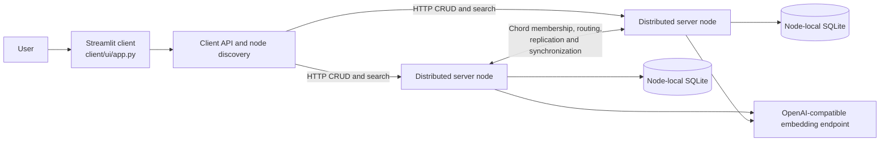

# InfoChord

**InfoChord is a research prototype for distributed semantic document search.** It combines a Streamlit client, an OpenAI-compatible embedding service, and Python server nodes organized around a Chord-inspired ring. The repository is useful as a systems/AI portfolio project; it is not a production-ready or security-audited document service.

## What it demonstrates

- A client for document insertion, update, deletion, search, and retrieval.
- Text chunking and vector embedding through an external OpenAI-compatible endpoint.
- A distributed node layer that routes document and query work through the ring and stores data in node-local SQLite databases.
- A containerized, multi-process development setup that can be explored locally.

The source includes replication and node-synchronization logic. The repository does not currently include automated tests that establish durability, consistency, availability, or recovery guarantees. Treat those properties as implementation goals, not verified service-level guarantees.

## Architecture



At a high level, the UI calls the client API; the API discovers server nodes; nodes coordinate ownership, storage, and query work; and embedding-dependent operations call the configured provider. Each Compose node gets its own mounted database and log directory. The diagram is conceptual and does not imply that every failure or recovery scenario has been validated.

### Request flow (source-level)

- **Search**: `client/api.py` selects a known node and requests `/query`. The distributed search code passes a query handle along successor nodes, checks database stability, and adds local matching documents before returning results.
- **Document CRUD**: the client sends a serialized request to a selected node; the server can redirect it to the current owner. Insert/update report progress through a separate endpoint.
- **Embedding**: node-side document processing calls the configured OpenAI-compatible API. A reachable provider/model is required for embedding-dependent work.

These are descriptions of the current code paths, not runtime-verified claims about correctness during failures or topology changes.

## UI snapshots

The repository includes two original UI examples:


### Code map

| Area | Responsibility |
| --- | --- |
| `client/ui/` | Streamlit pages and user interaction |
| `client/api.py`, `client/discovery.py` | Client requests and server discovery |
| `distributed/server.py`, `distributed/searcher.py` | Node startup, service endpoints, search coordination |
| `distributed/chord/` | Chord-oriented membership, storage, replication, and synchronization |
| `distributed/helper/` | Persistence, document processing, embeddings, and query helpers |
| `shared/` | Shared logging utility |

## Requirements

- Docker Engine/Desktop with Compose v2.
- An OpenAI-compatible embedding endpoint reachable from the containers. The default is `http://host.docker.internal:1234/v1`, intended for a local provider such as LM Studio.
- The embedding model configured in `distributed/config.py` must be available from that provider. Defaults can be overridden with `EMBEDDING_BASE_URL`, `EMBEDDING_API_KEY`, and `EMBEDDING_MODEL` in the root `.env` file (start from `.env.example`).

## Run a local demo

Compose creates seven interactive node containers and one client container. It does **not** automatically start the node or UI processes; start those manually after the containers are up.

1. Create local configuration and set provider values if needed:

   ```powershell
   Copy-Item .env.example .env
   # Edit .env with local, non-committed overrides when required.
   ```

2. Build the image and create the containers:

   ```powershell
   docker build -t chord_test .
   docker compose up -d
   docker compose ps
   ```

3. In separate terminals, start at least three server processes (example):

   ```powershell
   docker exec -it -w /app/code node_1 python server.py
   docker exec -it -w /app/code node_2 python server.py
   docker exec -it -w /app/code node_3 python server.py
   ```

4. Start the client UI:

   ```powershell
   docker exec -it -w /app/code client_1 streamlit run ui/app.py --server.address 0.0.0.0
   ```

5. Open [http://localhost:8501](http://localhost:8501). Use disposable, non-sensitive sample text for the demo.

The Docker daemon and embedding endpoint must be available for a live run. Do not upload private documents to a demo environment. Data and logs are stored in local directories mounted by Compose; remove demo data only after stopping the containers and confirming the relevant local paths.

To stop the containers:

```powershell
docker compose down
```

## Configuration

| Variable | Default | Purpose |
| --- | --- | --- |
| `EMBEDDING_BASE_URL` | `http://host.docker.internal:1234/v1` | OpenAI-compatible embeddings API base URL |
| `EMBEDDING_API_KEY` | `lm-studio` | API key passed to the OpenAI client; use a local-only value for providers that do not require authentication |
| `EMBEDDING_MODEL` | `nomic-ai/nomic-embed-text-v1.5-GGUF` | Embedding model identifier sent to the provider |
| `CHORD_PORT` | `8001` | Node protocol port |
| `HTTP_PORT` | `8000` | Node HTTP API port |

`.env` is local configuration and must not contain real credentials in a public checkout. `.env.example` contains safe defaults only.

## Validation status

- **Automated tests:** a standard-library regression test covers the UI delete confirmation (`python -m unittest discover -s tests -v`). `distributed/chord/clients_test/` contains additional manual client scripts that require a running cluster.
- **Compose configuration:** `docker compose config --quiet` passed during repository review; Compose reports the legacy top-level `version` field as obsolete.
- **Runtime demo:** not verified in this environment because the Docker daemon was unavailable and the `chord_test` image was not present.
- **Distributed guarantees:** no fault-injection or consistency test results are currently published.

## Safety and known limitations

- The UI is a prototype; use disposable data and do not expose it to untrusted users.
- Operations depend on a compatible embedding service and model being available.
- Compose starts interactive containers, not a health-checked production cluster.
- The project has no automated coverage for node failure, recovery, consistency, or multi-node CRUD behavior.
- The Dockerfile and dependency stack need modernization and a reproducible build audit before production use.

## Spec-driven project notes

GitHub Spec Kit is initialized in `.specify/`; the project constitution and showcase specification are under `specs/001-infochord-showcase/`. The specification records project expectations and validation gaps; it is not evidence that those guarantees are already implemented.
