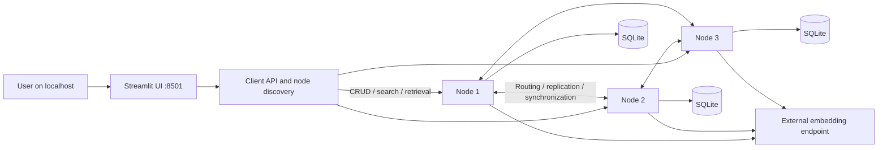

# InfoChord

**A research prototype for distributed semantic document search:** Streamlit, an OpenAI-compatible embedding service, and Python nodes organized around a Chord-inspired ring, each with SQLite storage.

This is a systems/AI portfolio project, **not a production-ready or security-audited service**. Implemented replication and synchronization logic are not proof of general consistency, availability or durability guarantees.

## What it demonstrates

- Document insertion, update, explicit-confirmation deletion, semantic search and text retrieval.
- Chunking and external vector embeddings, with distributed routing and node-local persistence.
- Versioned JSON contracts instead of executable object deserialization.
- A three-node Docker demo, readiness checks, bounded client operations and an automated integration gate.



The diagram is conceptual. CRUD may redirect to the owner; search carries a query handle around successor nodes, aggregates local matches, and checks stability. See [protocol and compatibility](docs/protocol.md).

## Quick start — real embeddings

Requirements: Docker Desktop/Engine, Compose **2.24.4+**, PowerShell, and a reachable OpenAI-compatible embedding provider with the configured model. The default endpoint targets a local provider such as LM Studio; no model or provider server is bundled.

```powershell
Copy-Item .env.example .env
# Edit .env to match your provider, key and loaded model. Never commit credentials.
./scripts/start-demo.ps1
```

Open **http://localhost:8501**. Startup builds the image, checks the actual provider with disposable sample text, and starts three nodes and the UI automatically. No separate `docker exec` terminals are needed.

Only the UI is published, bound to `127.0.0.1`. Node HTTP, RPC and discovery stay on the Compose network. Use disposable, non-sensitive text only.

```powershell
./scripts/stop-demo.ps1
```

Stopping preserves database volumes. The new demo uses isolated v1 volumes; old host database directories are not mounted, migrated or deleted. See the [two-minute walkthrough, capture checklist and troubleshooting](docs/demo.md).

To explore seven nodes after the default demo is running:

```powershell
docker compose --profile seven up -d --wait --wait-timeout 300
# Stop optional nodes too, without deleting their data:
docker compose --profile seven down
```

## Tests and reproducibility

Python 3.11+ is required on the host **only for the test orchestrator**; application/test dependencies run inside the Docker image.

```powershell
python scripts/check-demo.py
# PowerShell wrapper:
./scripts/test-demo.ps1
```

The gate builds a fresh image, runs unit tests, then starts a uniquely named isolated cluster. It exercises CRUD/search, owner redirection, provider outage, persisted data across restart, one stopped node and recovery. It stops only its own project and retains its volumes for inspection. CI runs the same command and saves diagnostics.

**The deterministic embedding fixture is a test double, not a semantic model.** Passing fixture tests does not establish search quality with a real provider.

For unit tests in an explicitly configured local Python environment:

```powershell
python -m pip install --require-hashes -r requirements.txt
python -m unittest discover -s tests -v
```

The base image is pinned by digest. `requirements.in` lists direct dependencies; `requirements.txt` locks transitive versions and hashes. Unused spaCy/scikit-learn/SciPy dependencies were removed; the tiktoken tokenizer cache is populated while building, not at startup. Regenerate intentionally with:

```powershell
uv pip compile requirements.in --python-version 3.11 --universal --generate-hashes --upgrade -o requirements.txt
```

## Configuration

| Variable | Default / purpose |
| --- | --- |
| `EMBEDDING_BASE_URL` | `http://host.docker.internal:1234/v1` |
| `EMBEDDING_API_KEY` | `lm-studio`; local-only placeholder, not a real credential |
| `EMBEDDING_MODEL` | `nomic-ai/nomic-embed-text-v1.5-GGUF`; must be available from the provider |
| `DB_PATH` | Compose uses `sqlite:////app/database/database.db` in each isolated volume |
| `CHORD_PORT`, `HTTP_PORT` | Internal node ports, 8001 and 8000 |
| `LOG_DIR` | `/app/logs`; application logs retain operation/error types, not document bodies or keys |

## Validation status and limitations

| Area | Implemented | Evidence |
| --- | --- | --- |
| Safe deletion UI | Explicit name, confirmation and button | Automated regression tests |
| JSON contracts and TCP framing | Version, allow-list, size/depth checks, partial reads | Unit tests; no security certification |
| JSON persistence and legacy rejection | New v1 storage; old files preserved | New-process persistence and unchanged-legacy-file tests |
| Client failures | Bounded retries/redirects/polling, visible errors | Unit tests |
| Multi-node CRUD and failure scenarios | Integration gate and CI workflow | **See [latest local evidence](docs/validation.md); do not infer a pass from test existence** |
| Real-provider demo and current capture | Walkthrough and preflight provided | Pending until explicitly recorded in validation evidence |

- No authentication, public deployment, load testing or general fault-tolerance guarantees.
- Client and nodes must upgrade together. No mixed-version rollout or automatic legacy-data migration.
- Title-based document identity remains unchanged and is not collision-resistant; do not use this prototype for irreplaceable documents.
- A single successful failure/recovery scenario is not proof of consistency under arbitrary failures or topology changes.

## Code map

| Area | Responsibility |
| --- | --- |
| `client/` | Streamlit, discovery and bounded HTTP client |
| `distributed/server.py`, `distributed/searcher.py` | Node startup and distributed query coordination |
| `distributed/chord/` | Membership, routing, replication and synchronization |
| `distributed/helper/` | Documents, embeddings, query ranking and SQLite |
| `infochord_protocol/` | Shared allow-listed JSON contracts and framing |
| `tests/`, `scripts/` | Unit/integration scenarios, fixtures and demo commands |

Spec Kit is initialized in `.specify/`; expectations and tracked work are under `specs/001-infochord-showcase/`. Specifications describe acceptance criteria, not completed guarantees.

### Historical UI examples

These screenshots predate the current interface and are **not current runtime evidence**:


